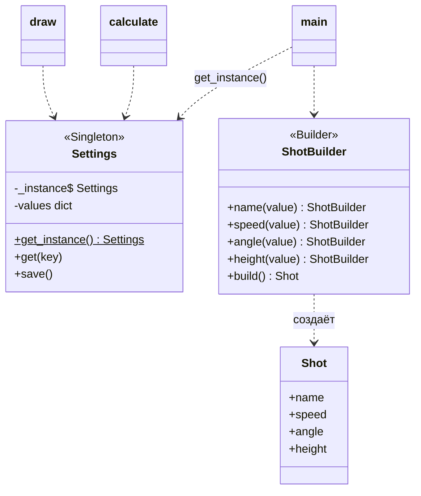

# Лабораторная работа №1. Порождающие паттерны: Одиночка, Строитель

**Дисциплина:** Паттерны проектирования  
**Выполнил:** Шевченко Денис Александрович, 4 курс, группа ПИЖ-б-о-23-2, 09.03.04 «Программная инженерия», очная форма обучения  
**Проверил:** канд. техн. наук, доцент Николаев Е.И.  
**Вариант:** 12 — «Расчёт баллистической траектории»

## Цель работы

Изучить порождающие паттерны «Одиночка» и «Строитель» и применить их в приложении для расчёта баллистической траектории.

## Задание

Приложение должно позволять задавать начальную скорость и угол к горизонту, рисовать траекторию, выводить максимальную высоту и дальность полёта, сохранять исходные данные в файл и иметь пользовательские настройки.

Программа спрашивает название снаряда, скорость, угол и высоту старта, считает полёт без сопротивления воздуха, рисует траекторию символами в консоли и дописывает исходные данные в `shots.txt`. Настройки (11 штук: g, размеры и символы графика, число знаков после запятой, имя файла и др.) хранятся в `settings.json`. Файл создаётся при первом запуске, его можно редактировать.

Расчётные формулы: `vx = v0·cos α`, `vy = v0·sin α`, время полёта `T = (vy + √(vy² + 2·g·h0)) / g`, дальность `L = vx·T`, высота `H = h0 + vy² / (2g)`.

## Применённые паттерны

**Одиночка (Singleton)** — класс `Settings`. Настройки должны быть общими для всей программы: функции расчёта и рисования должны видеть одни и те же значения. Поэтому объект создаётся один раз и хранится в поле класса `_instance`. Получают его только через `Settings.get_instance()`: при первом вызове объект создаётся и читает файл, при следующих возвращается тот же самый.

**Строитель (Builder)** — класс `ShotBuilder`. У выстрела есть обязательные параметры (скорость, угол) и необязательные (название, высота старта). Строитель собирает их по шагам. Каждый метод возвращает `self`, поэтому вызовы пишутся цепочкой. Метод `build()` проверяет данные и только потом создаёт объект `Shot`.



## Ключевой код

Одиночка: единственный объект хранится в поле класса `_instance = None` и создаётся при первом обращении.

```python
@classmethod
def get_instance(cls):
    # объект создаётся только при первом вызове, потом возвращается тот же
    if cls._instance is None:
        cls._instance = Settings()
    return cls._instance
```

Строитель: проверка данных перед созданием объекта.

```python
def build(self):
    if self._speed is None or self._speed <= 0:
        raise ValueError("скорость должна быть больше нуля")
    if self._angle is None or not 0 <= self._angle <= 90:
        raise ValueError("угол должен быть от 0 до 90 градусов")
    if self._height < 0:
        raise ValueError("высота старта не может быть отрицательной")
    return Shot(self._name, self._speed, self._angle, self._height)
```

Использование строителя (цепочка вызовов):

```python
shot = (ShotBuilder()
        .name(input("Название снаряда: "))
        .speed(float(input("Скорость, м/с: ")))
        .angle(float(input("Угол, град: ")))
        .height(float(input("Высота старта, м: ")))
        .build())
```

## Запуск

```
cd lab1
python main.py
```

## Результаты

Выстрел со скоростью 50 м/с под углом 45°. Высота 63,71 м и дальность 254,84 м совпадают с расчётом по формулам: `50²·sin²45° / (2·9,81) = 63,71`, `50²·sin 90° / 9,81 = 254,84`. Последняя строка подтверждает, что `get_instance()` всегда возвращает один и тот же объект.

```
> python main.py
=== Расчёт баллистической траектории ===
Название снаряда: Ядро
Скорость, м/с: 50
Угол, град: 45
Высота старта, м: 0
  |                        ************                        
  |                    *****          *****                    
  |                 ****                  ****                 
  |               ***                        ***               
  |             ***                            ***             
  |           ***                                ***           
  |         ***                                    ***         
  |        **                                        **        
  |       **                                          **       
  |     **                                              **     
  |    **                                                **    
  |   **                                                  **   
  |  **                                                    **  
  | *                                                        * 
  |*                                                          *
  |A===========================================================
Максимальная высота: 63.71 м
Дальность полёта:    254.84 м
Время полёта:        7.21 с
Исходные данные сохранены в shots.txt
Settings - один объект: True
```

При некорректных данных строитель не создаёт объект:

```
> python main.py
=== Расчёт баллистической траектории ===
Название снаряда: Стрела
Скорость, м/с: -5
Угол, град: 30
Высота старта, м: 0
Ошибка: скорость должна быть больше нуля
```

## Вывод

Изучены порождающие паттерны «Одиночка» и «Строитель». «Одиночка» дал программе один общий объект настроек, который загружается из файла и сохраняется в файл. «Строитель» позволил создавать выстрел по шагам с проверкой входных данных. Результаты расчёта совпадают с аналитическими формулами.
