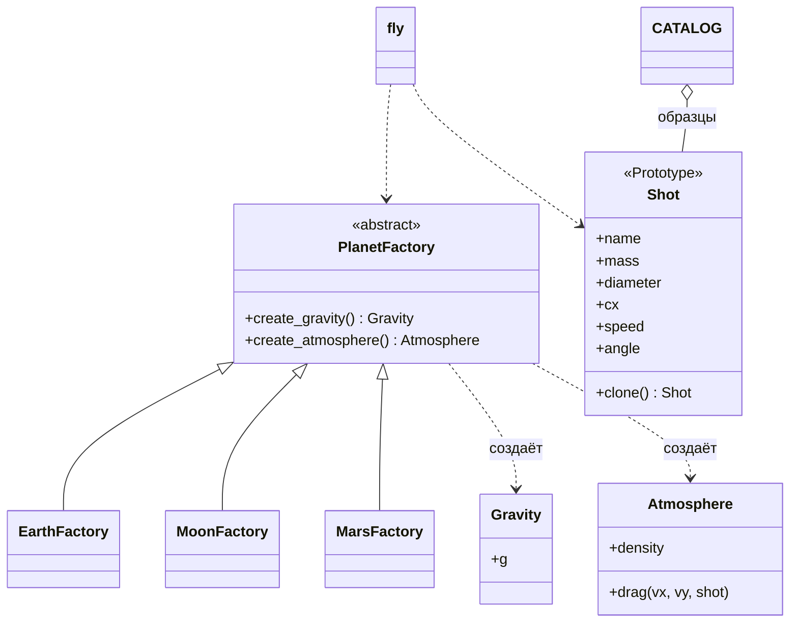

# Лабораторная работа №2. Порождающие паттерны: Абстрактная фабрика, Фабричный метод, Прототип

**Дисциплина:** Паттерны проектирования  
**Выполнил:** Шевченко Денис Александрович, 4 курс, группа ПИЖ-б-о-23-2, 09.03.04 «Программная инженерия», очная форма обучения  
**Проверил:** канд. техн. наук, доцент Николаев Е.И.  
**Вариант:** 12 — «Расчёт баллистической траектории»

## Цель работы

Изучить порождающие паттерны «Абстрактная фабрика», «Фабричный метод» и «Прототип» и применить два из них — «Абстрактную фабрику» и «Прототип» — в приложении для расчёта баллистической траектории.

## Задание

Один и тот же снаряд запускается на Земле, Луне и Марсе. Планеты отличаются ускорением свободного падения и плотностью атмосферы, поэтому полёт считается с сопротивлением воздуха `F = 0,5·ρ·Cx·S·v²`. Аналитического решения в этом случае нет, поэтому используется численный метод Эйлера с шагом 0,001 с. Программа делает серию выстрелов под углами от 15° до 75° и находит угол, при котором дальность максимальна.

| Планета | g, м/с² | ρ, кг/м³ |
|---|---|---|
| Земля | 9,81 | 1,225 |
| Луна | 1,62 | 0 |
| Марс | 3,71 | 0,020 |

## Применённые паттерны

**Абстрактная фабрика (Abstract Factory).** Для расчёта нужны два связанных объекта — тяжесть (`Gravity`) и атмосфера (`Atmosphere`), — и они обязательно должны относиться к одной планете. Базовый класс `PlanetFactory` объявляет методы `create_gravity()` и `create_atmosphere()`, а фабрики `EarthFactory`, `MoonFactory` и `MarsFactory` создают каждая свою пару. Функция `fly()` получает фабрику и не знает, какая это планета. Чтобы добавить новую планету, достаточно написать новую фабрику.

**Прототип (Prototype).** Класс `Shot` (снаряд) умеет копировать себя методом `clone()`. В словаре `CATALOG` хранятся готовые образцы снарядов. Пользователь выбирает образец и получает его копию, поэтому массу, диаметр и коэффициент сопротивления вводить не нужно. Серия выстрелов тоже строится копированием: у каждой копии меняется только угол, а образец остаётся прежним. Все поля — числа и строки, поэтому достаточно поверхностной копии `copy.copy`.



## Ключевой код

Абстрактная фабрика и одна из конкретных фабрик:

```python
class PlanetFactory:
    """
    Паттерн «Абстрактная фабрика»: каждая планета создаёт свою пару
    «тяжесть + атмосфера». Остальной код не знает, какая это планета.
    """
    name = "?"

    def create_gravity(self):
        raise NotImplementedError

    def create_atmosphere(self):
        raise NotImplementedError


class EarthFactory(PlanetFactory):
    name = "Земля"

    def create_gravity(self):
        return Gravity(9.81)

    def create_atmosphere(self):
        return Atmosphere(1.225)
```

Прототип:

```python
def clone(self):
    # все поля - числа и строки, поэтому поверхностной копии достаточно
    return copy.copy(self)
```

Расчёт пользуется только фабрикой, не зная планеты:

```python
def fly(shot, planet):
    """Полёт методом Эйлера с шагом 0.001 с. Возвращает дальность, м."""
    gravity = planet.create_gravity()
    air = planet.create_atmosphere()
    a = math.radians(shot.angle)
    vx, vy = shot.speed * math.cos(a), shot.speed * math.sin(a)
    x = y = 0.0
    dt = 0.001
    while True:
        ax, ay = air.drag(vx, vy, shot)
        vx += ax * dt
        vy += (ay - gravity.g) * dt
        x += vx * dt
        y += vy * dt
        if y <= 0:
            return x
```

Серия выстрелов — копии прототипа с разными углами:

```python
for angle in range(15, 76, 5):
    shot = base.clone()     # копия прототипа, меняем только угол
    shot.angle = angle
    row = f"{angle:<6}"
    for p in planets:
        distance = fly(shot, p)
        row += f"{distance:>10.1f}"
        if distance > best[p.name][0]:
            best[p.name] = (distance, angle)
    print(row)
```

## Запуск

```
cd lab2
python main.py
```

## Результаты

Теннисный мяч, скорость 40 м/с. На Луне сопротивления нет: дальность при 45° равна 987,6 м, что практически совпадает с формулой для вакуума `v0²/g = 40²/1,62 = 987,7 м`, и лучший угол, как и положено, 45°. На Земле лёгкий мяч сильно тормозится воздухом, поэтому лучший угол смещается к 35°. После серии угол исходного снаряда не изменился — менялись только копии.

```
> python main.py
=== Баллистика на разных планетах ===
  1 - Пушечное ядро
  2 - Теннисный мяч
  3 - Бадминтонный волан
Выберите снаряд: 2
Скорость, м/с: 40

Угол       Земля      Луна      Марс
15          41.4     493.8     205.5
20          47.1     634.8     260.6
25          51.0     756.6     306.8
30          53.3     855.3     343.2
35          54.3     928.1     369.0
40          54.2     972.6     383.9
45          52.9     987.6     387.7
50          50.7     972.6     380.3
55          47.4     928.1     362.1
60          43.2     855.3     333.4
65          38.1     756.6     295.1
70          32.0     634.8     248.0
75          25.1     493.8     193.3

Земля: лучший угол 35 град, дальность 54.3 м
Луна: лучший угол 45 град, дальность 987.6 м
Марс: лучший угол 45 град, дальность 387.7 м
Угол у исходного снаряда не изменился: 45
```

## Вывод

Изучены порождающие паттерны «Абстрактная фабрика», «Фабричный метод» и «Прототип»; в программе применены первый и третий. «Абстрактная фабрика» создаёт согласованные пары «тяжесть + атмосфера» и позволяет добавлять планеты без изменения расчёта. «Прототип» избавляет от повторного ввода параметров снаряда и упрощает серию выстрелов. Результаты для Луны совпадают с аналитической формулой, для Земли видно влияние сопротивления воздуха.
