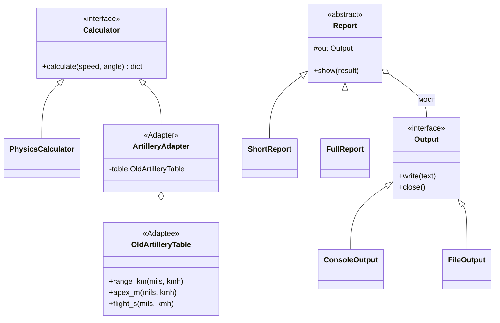

# Лабораторная работа №3. Структурные паттерны: Адаптер, Мост

**Дисциплина:** Паттерны проектирования  
**Выполнил:** Шевченко Денис Александрович, 4 курс, группа ПИЖ-б-о-23-2, 09.03.04 «Программная инженерия», очная форма обучения  
**Проверил:** канд. техн. наук, доцент Николаев Е.И.  
**Вариант:** 12 — «Расчёт баллистической траектории»

## Цель работы

Изучить структурные паттерны «Адаптер» и «Мост» и применить их в приложении для расчёта баллистической траектории.

## Задание

Пользователь вводит скорость и угол, выбирает способ расчёта, место вывода (консоль или файл) и вид отчёта (краткий или подробный с точками траектории).

Для демонстрации адаптера считаем, что в программу нужно подключить готовый модуль из старой программы для артиллеристов — класс `OldArtilleryTable`. Менять его нельзя, а интерфейс у него неудобный: угол задаётся в делениях угломера (полный круг — 6000 делений), скорость — в км/ч, дальность возвращается в километрах.

## Применённые паттерны

**Адаптер (Adapter).** Программа работает с интерфейсом `Calculator`: метод `calculate(speed, angle)` принимает м/с и градусы и возвращает результат в метрах. Свой калькулятор `PhysicsCalculator` считает по формулам `L = v0²·sin 2α / g`, `H = (v0·sin α)² / 2g`, `T = 2·v0·sin α / g`. Класс `ArtilleryAdapter` реализует тот же интерфейс, а внутри хранит старый модуль, переводит единицы, вызывает его методы и переводит ответ обратно. Для программы старый модуль выглядит как обычный калькулятор.

**Мост (Bridge).** У отчёта две независимые характеристики: *что* выводится (краткий или подробный отчёт) и *куда* (консоль или файл). Абстракция `Report` хранит ссылку на реализацию `Output` и выводит текст только через её метод `write()`. Любой отчёт можно соединить с любым выводом: без моста понадобилось бы 2 × 2 = 4 класса, а с мостом их 2 + 2.



## Ключевой код

Адаптер переводит единицы и вызывает старый модуль:

```python
class ArtilleryAdapter(Calculator):
    """
    Паттерн «Адаптер»: реализует наш интерфейс Calculator,
    а внутри переводит единицы и вызывает старый модуль.
    """

    def __init__(self, table):
        self.table = table  # адаптируемый объект

    def calculate(self, speed, angle):
        mils = angle / 360 * 6000   # градусы -> деления угломера
        kmh = speed * 3.6           # м/с -> км/ч
        return {
            "distance": self.table.range_km(mils, kmh) * 1000,  # км -> м
            "height": self.table.apex_m(mils, kmh),
            "time": self.table.flight_s(mils, kmh),
        }
```

Мост: отчёт пишет только через `self.out`, не зная, консоль это или файл.

```python
class Report:
    """
    Паттерн «Мост»: абстракция «отчёт» хранит ссылку на реализацию Output.
    Любой вид отчёта работает с любым способом вывода.
    """

    def __init__(self, output):
        self.out = output

    def show(self, result):
        raise NotImplementedError


class ShortReport(Report):
    def show(self, r):
        self.out.write(f"Дальность {r['distance']:.2f} м, высота {r['height']:.2f} м")
        self.out.close()
```

Сборка в `main()`: калькулятор, вывод и отчёт выбираются независимо.

```python
if input("Расчёт: 1 - формулы, 2 - старый модуль: ") == "2":
    calculator = ArtilleryAdapter(OldArtilleryTable())
else:
    calculator = PhysicsCalculator()

if input("Вывод: 1 - консоль, 2 - файл: ") == "2":
    output = FileOutput("report.txt")
else:
    output = ConsoleOutput()

if input("Отчёт: 1 - краткий, 2 - подробный: ") == "2":
    report = FullReport(output)
else:
    report = ShortReport(output)

report.show(calculator.calculate(speed, angle))
```

## Запуск

```
cd lab3
python main.py
```

## Результаты

Один и тот же выстрел (60 м/с, 30°) посчитан своими формулами и старым модулем через адаптер. Результаты совпадают: дальность 317,81 м, высота 45,87 м, время 6,12 с. Значит, адаптер переводит единицы правильно.

```
> python main.py
=== Отчёты о выстреле ===
Скорость, м/с: 60
Угол, град: 30
Расчёт: 1 - формулы, 2 - старый модуль: 1
Вывод: 1 - консоль, 2 - файл: 1
Отчёт: 1 - краткий, 2 - подробный: 2
=== Подробный отчёт ===
Дальность: 317.81 м
Высота:    45.87 м
Время:     6.12 с
Точки траектории (x; y):
      0.00;   0.00
     63.56;  29.36
    127.12;  44.04
    190.68;  44.04
    254.25;  29.36
    317.81;   0.00
```

```
> python main.py
=== Отчёты о выстреле ===
Скорость, м/с: 60
Угол, град: 30
Расчёт: 1 - формулы, 2 - старый модуль: 2
Вывод: 1 - консоль, 2 - файл: 1
Отчёт: 1 - краткий, 2 - подробный: 2
=== Подробный отчёт ===
Дальность: 317.81 м
Высота:    45.87 м
Время:     6.12 с
Точки траектории (x; y):
      0.00;   0.00
     63.56;  29.36
    127.12;  44.04
    190.68;  44.04
    254.25;  29.36
    317.81;   0.00
```

Тот же адаптер с другой комбинацией моста: краткий отчёт записан в файл. Содержимое `report.txt`:

```
> python main.py
=== Отчёты о выстреле ===
Скорость, м/с: 60
Угол, град: 30
Расчёт: 1 - формулы, 2 - старый модуль: 2
Вывод: 1 - консоль, 2 - файл: 2
Отчёт: 1 - краткий, 2 - подробный: 1
Отчёт сохранён в report.txt
```

```
Дальность 317.81 м, высота 45.87 м
```

## Вывод

Изучены структурные паттерны «Адаптер» и «Мост». Адаптер позволил подключить модуль с несовместимым интерфейсом и другими единицами измерения, не меняя его код. Мост отделил виды отчётов от способов вывода: новые отчёты и новые способы вывода добавляются независимо друг от друга.
