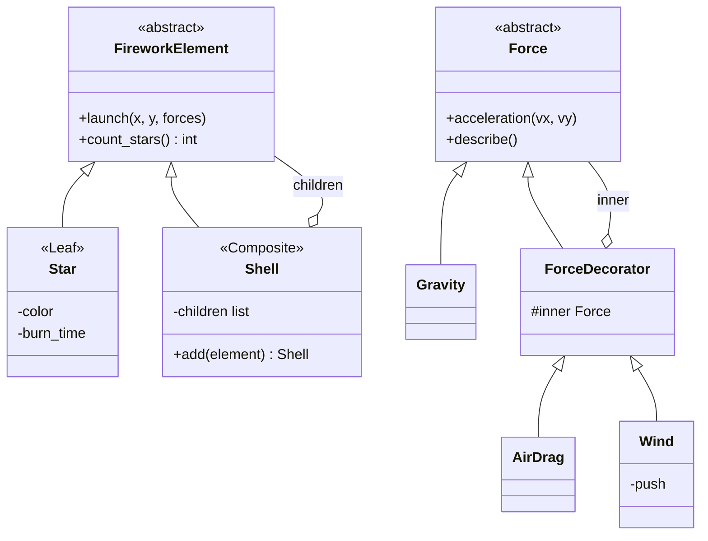

# Лабораторная работа №4. Структурные паттерны: Компоновщик, Декоратор

**Дисциплина:** Паттерны проектирования  
**Выполнил:** Шевченко Денис Александрович, 4 курс, группа ПИЖ-б-о-23-2, 09.03.04 «Программная инженерия», очная форма обучения  
**Проверил:** канд. техн. наук, доцент Николаев Е.И.  
**Вариант:** 12 — «Расчёт баллистической траектории»

## Цель работы

Изучить структурные паттерны «Компоновщик» и «Декоратор» и применить их в приложении для расчёта баллистической траектории.

## Задание

Прикладная задача — расчёт салюта. Главный заряд взлетает и через заданное время взрывается, выпуская вложенные заряды и звёздочки. Вложенные заряды тоже взрываются и выпускают свои звёздочки. Полёт каждого элемента — баллистическая траектория (метод Эйлера, шаг 0,01 с). Программа показывает, где взорвётся каждый заряд и где погаснет каждая звёздочка, и предупреждает, если звёздочка долетает до земли горящей. Пользователь выбирает, учитывать ли сопротивление воздуха и ветер, и задаёт скорость главного заряда.

## Применённые паттерны

**Компоновщик (Composite).** Салют — это дерево. Общий интерфейс — `FireworkElement` с методами `launch()` и `count_stars()`. Лист — `Star` (звёздочка), контейнер — `Shell` (заряд) со списком вложенных элементов. Заряд в `launch()` долетает до точки взрыва и вызывает `launch()` у каждого вложенного элемента, а `count_stars()` суммирует ответы детей. Программа работает со всем салютом как с одним элементом.

**Декоратор (Decorator).** Силы, действующие на частицу, набираются обёртками. Общий интерфейс — `Force`. Базовый объект `Gravity` даёт только тяжесть. Декораторы `AirDrag` и `Wind` хранят обёрнутый объект, берут у него ускорение и добавляют своё. Модель собирается во время работы, например `Wind(AirDrag(Gravity()), -1.5)`. Без декоратора пришлось бы писать отдельный класс на каждую комбинацию сил.



## Ключевой код

Компоновщик: заряд запускает вложенные элементы из точки взрыва и рекурсивно считает звёздочки.

```python
class Shell(FireworkElement):
    """
    Паттерн «Компоновщик»: заряд содержит другие элементы (заряды или звёздочки)
    и работает с ними через тот же интерфейс launch() / count_stars().
    """

    def __init__(self, name, speed, angle, fuse_time):
        self.name, self.speed, self.angle, self.fuse_time = name, speed, angle, fuse_time
        self.children = []

    def add(self, element):
        self.children.append(element)
        return self

    def launch(self, x, y, forces, indent=""):
        x, y, landed = fly(x, y, self.speed, self.angle, self.fuse_time, forces)
        if landed:
            print(f"{indent}Заряд «{self.name}»: упал, не успев взорваться!")
            return
        print(f"{indent}Заряд «{self.name}»: взрыв в ({x:.1f}; {y:.1f})")
        for child in self.children:              # дети стартуют из точки взрыва
            child.launch(x, y, forces, indent + "    ")

    def count_stars(self):
        return sum(child.count_stars() for child in self.children)
```

Декоратор: обёртка берёт ускорение у вложенного объекта и добавляет своё.

```python
class AirDrag(ForceDecorator):
    """Сопротивление воздуха: a = -k * |v| * v."""
    K = 0.01

    def acceleration(self, vx, vy):
        ax, ay = self.inner.acceleration(vx, vy)
        v = math.hypot(vx, vy)
        return ax - self.K * v * vx, ay - self.K * v * vy

    def describe(self):
        return self.inner.describe() + " + воздух"
```

Сборка модели сил обёртками:

```python
forces = Gravity()
if input("Учитывать воздух? (д/н): ") == "д":
    forces = AirDrag(forces)
if input("Учитывать ветер? (д/н): ") == "д":
    forces = Wind(forces, float(input("Ускорение ветра, м/с^2: ")))
```

## Запуск

```
cd lab4
python main.py
```

## Результаты

Без воздуха и ветра, скорость главного заряда 70 м/с. Вывод повторяет структуру дерева, `count_stars()` корня вернул 8:

```
> python main.py
=== Расчёт салюта ===
Учитывать воздух? (д/н): н
Учитывать ветер? (д/н): н
Скорость главного заряда, м/с: 70
Модель сил: тяжесть
Звёздочек в салюте: 8

Заряд «Главный»: взрыв в (8.6; 184.6)
    Заряд «Пион»: взрыв в (18.6; 197.0)
        Звёздочка (красная): погасла в (48.6; 177.2)
        Звёздочка (красная): погасла в (18.6; 207.2)
        Звёздочка (красная): погасла в (-11.4; 177.2)
        Звёздочка (красная): погасла в (18.6; 147.2)
    Заряд «Ива»: взрыв в (-1.4; 197.0)
        Звёздочка (золотая): погасла в (24.0; 122.9)
        Звёздочка (золотая): погасла в (-26.9; 122.9)
    Звёздочка (белая): погасла в (41.0; 192.2)
    Звёздочка (белая): погасла в (-23.9; 192.2)
```

С воздухом и ветром (два декоратора): высота взрыва главного заряда упала со 184,6 м до 88,7 м, все точки сместились влево. Классы салюта при этом не менялись.

```
> python main.py
=== Расчёт салюта ===
Учитывать воздух? (д/н): д
Учитывать ветер? (д/н): д
Ускорение ветра, м/с^2: -1.5
Скорость главного заряда, м/с: 70
Модель сил: тяжесть + воздух + ветер (-1.5 м/с^2)
Звёздочек в салюте: 8

Заряд «Главный»: взрыв в (-2.4; 88.7)
    Заряд «Пион»: взрыв в (6.1; 99.9)
        Звёздочка (красная): погасла в (29.3; 82.0)
        Звёздочка (красная): погасла в (3.2; 108.5)
        Звёздочка (красная): погасла в (-22.2; 82.2)
        Звёздочка (красная): погасла в (3.4; 57.8)
    Заряд «Ива»: взрыв в (-12.3; 99.9)
        Звёздочка (золотая): погасла в (-4.3; 39.3)
        Звёздочка (золотая): погасла в (-44.3; 40.3)
    Звёздочка (белая): погасла в (24.0; 94.6)
    Звёздочка (белая): погасла в (-31.7; 94.6)
```

Скорость 40 м/с: заряды взрываются слишком низко, звёздочки «Ивы» долетают до земли горящими.

```
> python main.py
=== Расчёт салюта ===
Учитывать воздух? (д/н): д
Учитывать ветер? (д/н): н
Скорость главного заряда, м/с: 40
Модель сил: тяжесть + воздух
Звёздочек в салюте: 8

Заряд «Главный»: взрыв в (3.4; 46.1)
    Заряд «Пион»: взрыв в (12.7; 57.4)
        Звёздочка (красная): погасла в (38.4; 39.6)
        Звёздочка (красная): погасла в (12.7; 66.0)
        Звёздочка (красная): погасла в (-13.1; 39.6)
        Звёздочка (красная): погасла в (12.7; 15.3)
    Заряд «Ива»: взрыв в (-5.8; 57.4)
        Звёздочка (золотая): ВНИМАНИЕ! упала горящей в x = 14.1
        Звёздочка (золотая): ВНИМАНИЕ! упала горящей в x = -25.6
    Звёздочка (белая): погасла в (31.3; 52.1)
    Звёздочка (белая): погасла в (-24.4; 52.1)
```

## Вывод

Изучены структурные паттерны «Компоновщик» и «Декоратор». Компоновщик позволил описать многоступенчатый салют деревом и работать с ним через один интерфейс. Запуск и подсчёт звёздочек выполняются рекурсивно. Декоратор позволил собирать модель сил из независимых частей во время работы программы, без класса на каждую комбинацию.
