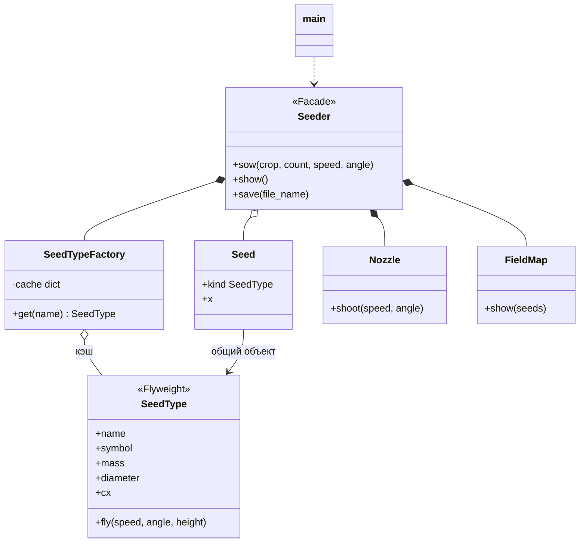

# Лабораторная работа №5. Структурные паттерны: Фасад, Приспособленец

**Дисциплина:** Паттерны проектирования  
**Выполнил:** Шевченко Денис Александрович, 4 курс, группа ПИЖ-б-о-23-2, 09.03.04 «Программная инженерия», очная форма обучения  
**Проверил:** канд. техн. наук, доцент Николаев Е.И.  
**Вариант:** 12 — «Расчёт баллистической траектории»

## Цель работы

Изучить структурные паттерны «Фасад» и «Приспособленец» и применить их в приложении для расчёта баллистической траектории.

## Задание

Прикладная задача — пневматическая сеялка, которая «выстреливает» семена на поле. Каждое семя летит по своей баллистической траектории с сопротивлением воздуха (метод Эйлера, шаг 0,001 с), поэтому лёгкие семена падают ближе, а тяжёлые — дальше. Пользователь высевает партии семян (горох, пшеница, подсолнечник), задавая количество, скорость и угол. У каждого семени скорость и угол немного отличаются из-за разброса: ±10 % и ±5°. Программа выводит среднюю дальность каждой партии, карту поля по полосам в 1 м и сохраняет итоги в `sowing.txt`.

## Применённые паттерны

**Приспособленец (Flyweight).** Семян тысячи, но у всех семян одной культуры одинаковые масса, диаметр, коэффициент сопротивления и символ на карте. Эти данные (*внутреннее состояние*) хранятся в одном объекте `SeedType` на культуру. Скорость и угол конкретного семени (*внешнее состояние*) в `SeedType` не хранятся, а передаются в метод `fly()` параметрами. Объекты `SeedType` выдаёт `SeedTypeFactory`: она запоминает созданные объекты и на повторный запрос возвращает тот же. Объект семени `Seed` хранит только ссылку на общий вид и место падения.

**Фасад (Facade).** Чтобы посеять партию, нужно взять вид семени у фабрики, для каждого семени получить у сопла (`Nozzle`) скорость и угол, рассчитать полёт, запомнить результат, а потом нарисовать карту (`FieldMap`) и записать итоги. Класс `Seeder` прячет всё это за тремя методами: `sow()`, `show()` и `save()`. Функция `main()` работает только с фасадом.



## Ключевой код

Фабрика приспособленцев: новый объект создаётся только для новой культуры.

```python
def get(self, name):
    if name not in self.cache:
        print(f"  (создан объект SeedType «{name}»)")
        self.cache[name] = SeedType(name, *self.DATA[name])
    return self.cache[name]
```

Фасад: один метод `sow()` скрывает работу фабрики, сопла и расчёта.

```python
def sow(self, crop, count, speed, angle):
    kind = self.factory.get(crop)
    total = 0.0
    for _ in range(count):
        v, a = self.nozzle.shoot(speed, angle)
        x = kind.fly(v, a, self.nozzle.height)
        self.seeds.append(Seed(kind, x))    # у всех семян один и тот же kind
        total += x
```

Клиент знает только про фасад:

```python
seeder = Seeder()
while True:
    crop = input("Культура: ").strip().lower()
    if not crop:
        break
    if crop not in SeedTypeFactory.DATA:
        print("Неизвестная культура")
        continue
    count = int(input("Количество семян: "))
    speed = float(input("Скорость, м/с: "))
    angle = float(input("Угол, град: "))
    seeder.sow(crop, count, speed, angle)

if seeder.seeds:
    seeder.show()
    seeder.save("sowing.txt")
```

## Запуск

```
cd lab5
python main.py
```

## Результаты

Высеяно четыре партии. Сообщение о создании `SeedType` появляется только при первом запросе культуры: для второй партии гороха фабрика вернула уже существующий объект. В итоге на 1300 объектов `Seed` приходится всего 3 объекта `SeedType`. На карте видно, что горох (12 м/с) лёг на 9–13 м, пшеница (25 м/с) — на 14–17 м, а лёгкий подсолнечник даже при 30 м/с сильнее тормозится воздухом и лёг на 13–15 м.

```
> python main.py
=== Пневматическая сеялка ===
Культуры: горох, пшеница, подсолнечник (пустая строка - закончить)
Культура: горох
Количество семян: 400
Скорость, м/с: 12
Угол, град: 30
  (создан объект SeedType «горох»)
горох: 400 шт., v = 12.0 м/с, угол = 30.0, средняя дальность 10.82 м
Культура: пшеница
Количество семян: 400
Скорость, м/с: 25
Угол, град: 30
  (создан объект SeedType «пшеница»)
пшеница: 400 шт., v = 25.0 м/с, угол = 30.0, средняя дальность 15.54 м
Культура: подсолнечник
Количество семян: 300
Скорость, м/с: 30
Угол, град: 25
  (создан объект SeedType «подсолнечник»)
подсолнечник: 300 шт., v = 30.0 м/с, угол = 25.0, средняя дальность 14.15 м
Культура: горох
Количество семян: 200
Скорость, м/с: 12
Угол, град: 30
горох: 200 шт., v = 12.0 м/с, угол = 30.0, средняя дальность 10.97 м
Культура: 

Карта поля (символ = 10 семян):
  9-10  м | ГГГГГГГГГГГГ
 10-11  м | ГГГГГГГГГГГГГГГГГГГГ
 11-12  м | ГГГГГГГГГГГГГГГГГГГГГГ
 12-13  м | ГГГГГГ
 13-14  м | ССССССССССССС
 14-15  м | ППППППППППСССССССССССССССС
 15-16  м | ППППППППППППППППППП
 16-17  м | ПППППППППППП

Объектов Seed: 1300, объектов SeedType: 3
Итоги сохранены в sowing.txt
```

## Вывод

Изучены структурные паттерны «Фасад» и «Приспособленец». Приспособленец вынес общие для тысяч семян данные в разделяемые объекты: на 1300 семян в памяти три объекта с данными культур. Фасад свёл работу с подсистемой сеялки к трём методам и отделил клиентский код от деталей реализации.
